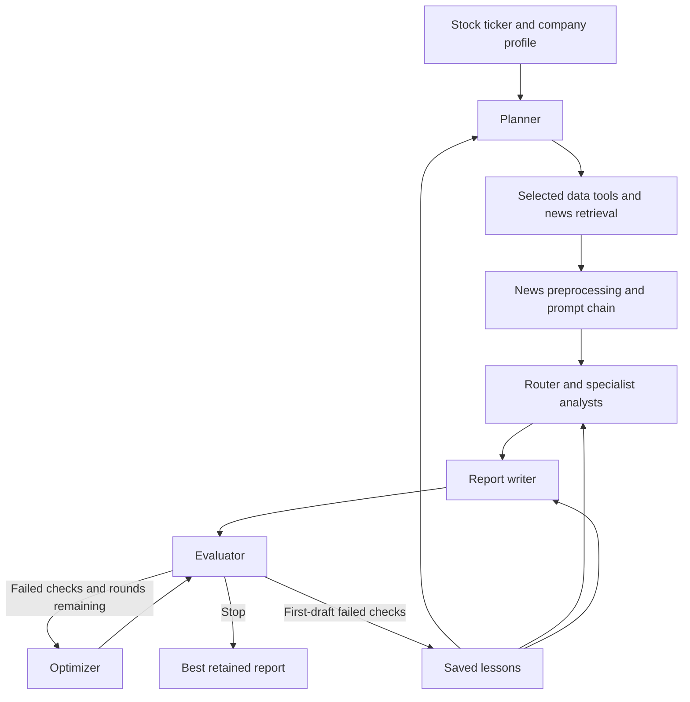

# Multi-Agent-Financial-Analysis-System
This project will consist in a system to build a real-world financial analysis system powered by agentic AI. Unlike traditional pipelines, agentic systems can reason, plan, and act, coordinating multiple specialized LLM agents to handle complex financial tasks end-to-end.
The primary deliverable is [`FinalProject_AAI_520.ipynb`](FinalProject_AAI_520.ipynb). It contains the implementation, a live research run, a routing evaluation, and sections for documenting results.

## Main Features
- Planning and tools: Selects relevant price, financial, valuation, and earnings data tools.
- Prompt chaining: Processes news through preprocessing, classification, fact extraction, and summarization.
- Routing: Sends relevant content to market, financial, and news specialists.
- Evaluator–Optimizer: Checks each report against a checklist and revises it using feedback.
- Memory: Saves failed first-draft checks as lessons for future analyses.

## Technology
Python, Google Colab, yfinance, NewsAPI, and the OpenAI API. Most model calls use gpt-4o-mini; model-based evaluation uses gpt-4o.

## Architecture

## Agent roles
| Component | Implementation | Responsibility |
| --- | --- | --- |
| Planner | `planner_agent()` | Requests three of four tools, selects `6mo`, `1y`, or `2y` of price history, and explains its choices. |
| Article processor | `article_agent()` | Calls classification, extraction, and summarization sequentially. |
| Router | `route_articles()` | Maps article categories to specialist analysts. |
| Specialists | `analyst_agent()` and `SPECIALISTS` | Produce findings from assigned tool data and up to five relevant article summaries. |
| Writer | `writer_agent()` | Combines findings and data into a five-section report. |
| Evaluator | `evaluator_agent()` | Applies Python checks and model-based checklist judgments. |
| Optimizer | `optimizer_agent()` | Revises the report to address failed checks. |
| Coordinator | `gather()` and `run_research()` | Handles retrieval, orchestration, revision rounds, and memory. |

## Recorded Results
The saved AAPL example improved from 52 to 92/100 after revision. Across MSFT, JNJ, and NVDA, the average first-draft checklist score increased from 54 without memory to 89 with memory, using shared gathered inputs for each ticker's comparison.
These are internal checklist scores from a small experiment, not measures of factual accuracy or investment performance. Full methodology, findings, and limitations are covered in the accompanying project report.
