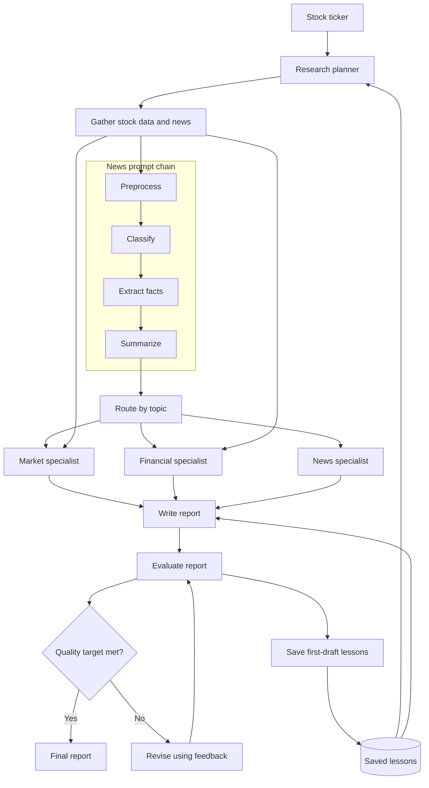

# Multi-Agent-Financial-Analysis-System
This project will consist in a system to build a real-world financial analysis system powered by agentic AI. Unlike traditional pipelines, agentic systems can reason, plan, and act, coordinating multiple specialized LLM agents to handle complex financial tasks end-to-end.
The primary deliverable is [`FinalProject_AAI_520.ipynb`](FinalProject_AAI_520.ipynb). It contains the implementation, a live research run, a routing evaluation, and sections for documenting results.

## Main Features
- Planning and tools: Selects relevant price, financial, valuation, and earnings data tools.
- Prompt chaining: Processes news through preprocessing, classification, fact extraction, and summarization.
- Routing: Sends relevant content to market, financial, and news specialists.
- Evaluator–Optimizer: Checks each report against a checklist and revises it using feedback.
- Memory: Saves failed first-draft checks as lessons for future analyses.

## Technology
Python, Google Colab, yfinance, NewsAPI, and the OpenAI API. Most model calls use gpt-4o-mini; model-based evaluation uses gpt-4o.

## Architecture

## Recorded Results
The saved AAPL example improved from 50 to 96/100 after revision. Across MSFT, JNJ, and NVDA, the average first-draft checklist score increased from 62 without memory to 84 with memory, using shared gathered inputs for each ticker's comparison.
These internal checklist scores come from one run per ticker per condition. They do not establish factual accuracy or investment performance; some final reports still exceeded the word limit. Full methodology, findings, and limitations are covered in the accompanying project report.
