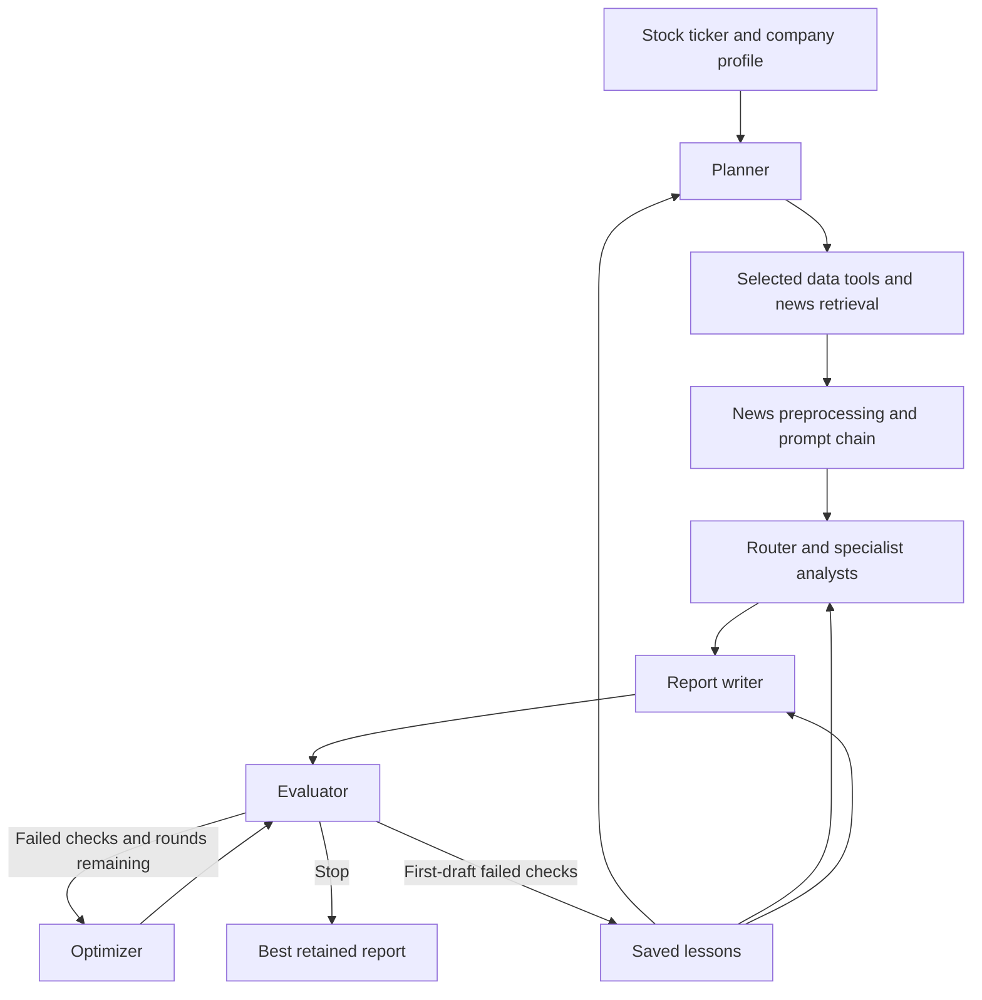

# Multy-Agent-Financial-Analysis-System
This project will consist in a system to build a real-world financial analysis system powered by agentic AI. Unlike traditional pipelines, agentic systems can reason, plan, and act, coordinating multiple specialized LLM agents to handle complex financial tasks end-to-end.
The primary deliverable is [Multi_agent_system_final.ipynb](Multi_agent_system_final.ipynb). It contains the implementation, a live research run, a routing evaluation, and sections for documenting results.

Investment Research Agent
A notebook-based agentic AI system that researches a stock ticker, selects financial data tools, processes recent news, and produces a short investment research report. The system evaluates its draft, revises failed checklist items, and saves lessons for future runs.
The implementation is in [`InvestmentResearchAgent_10_18.ipynb`](InvestmentResearchAgent_10_18.ipynb). It uses Python functions for the agent roles and orchestration.
Features
- Research planning: Uses the company profile and previous lessons to choose data tools and a price-history window.
- Dynamic tool selection: Selects from prices, financials, valuation, and earnings tools. News retrieval runs for every new research input.
- Prompt chaining: Processes news through ingestion, preprocessing, classification, fact extraction, and summarization.
- Specialist routing: Directs market, earnings, and company-event content to the appropriate analysts.
- Self-reflection and revision: Evaluates the report against a checklist and revises it using specific feedback.
- Memory across runs: Stores failed first-draft checks in agent_memory.json and reuses them as process reminders.
- Memory comparison: Reuses each ticker's gathered inputs to compare runs with and without saved lessons.
Architecture

Numerical metrics are retrieved or calculated in Python. Language models select tools, interpret data, process article previews, write reports, and evaluate checklist coverage.
Agent roles
Component	Implementation	Responsibility
Planner	planner_agent()	Requests three of four tools, selects 6mo, 1y, or 2y of price history, and explains its choices.
Article processor	article_agent()	Calls classification, extraction, and summarization sequentially.
Router	route_articles()	Maps article categories to specialist analysts.
Specialists	analyst_agent() and SPECIALISTS	Produce findings from assigned tool data and up to five relevant article summaries.
Writer	writer_agent()	Combines findings and data into a five-section report.
Evaluator	evaluator_agent()	Applies Python checks and model-based checklist judgments.
Optimizer	optimizer_agent()	Revises the report to address failed checks.
Coordinator	gather() and run_research()	Handles retrieval, orchestration, revision rounds, and memory.

Self-reflection occurs at the report level through the evaluator–optimizer loop. This version does not run a separate specialist self-review call.
Data sources and tools
Source / tool	Data used
Yahoo Finance — prices	Latest close, period return, annualized volatility, and maximum drawdown.
Yahoo Finance — financials	Annual revenue, growth, net income, margin, and free cash flow; debt-to-equity and current ratio from the latest quarterly balance sheet. Reporting dates are included.
Yahoo Finance — valuation	Trailing and forward price-to-earnings ratios.
Yahoo Finance — earnings	Latest reported quarterly EPS, analyst estimate, and calculated surprise percentage.
NewsAPI	Up to 10 English-language headlines and descriptions from the preceding 21 days, sorted by relevance.

The planner is prompted to choose three tools. Its returned names are filtered against the available tools, but an exact count of three is not enforced. If a selected data tool raises an error, run_tool() prints the error and returns an empty result so processing can continue.
News workflow and routing
get_news() → preprocess() → classify_article() → extract_facts() → summarize_facts()
Preprocessing normalizes whitespace, removes duplicate text, and excludes deleted articles. Classification and extraction use the first 600 characters of the combined headline and description. Summarization receives only the extracted facts.
Category	Destination	Additional tool data
market	Market analyst	Prices and valuation, when available.
earnings	Financial analyst	Financials and earnings, when available.
news	News analyst	Article summaries only.
irrelevant	Excluded	Processing stops after classification.

An analyst runs only when it has tool data or routed articles to analyze.
Getting started
Google Colab
The notebook is configured for Google Colab, including its Secrets interface.
1. Open InvestmentResearchAgent_10_18.ipynb in Colab.
2. Add and run a dependency cell before the imports:
   %pip install openai yfinance requests
3. Add these exact names in Colab Secrets and enable notebook access:
   Secret	Purpose
   OPENAI_API_KEY	Model calls for planning, analysis, writing, evaluation, and revision.
   NEWS_API_KEY	NewsAPI headline retrieval.
4. Run the definition cells in order, then the AAPL example.
5. Run the Memory test and its results cell to reproduce the comparison workflow.
The notebook uses gpt-4o-mini by default and gpt-4o for the model-based evaluator checks. API access and available usage credits are required. The memory test performs six research runs, with repeated evaluations and up to three revision rounds each.
Memory reset: The AAPL example deletes an existing agent_memory.json before starting. Skip that deletion when continuing with accumulated lessons. The file is stored in the working directory and is lost when an ephemeral Colab runtime is deleted unless it is saved elsewhere.
For local Jupyter use, replace the google.colab.userdata credential lookup with environment-variable access. Local credential loading is not implemented in the supplied notebook.
Run a different ticker
After executing the definition cells:
result = run_research("MSFT", max_rounds=3)
print(result["report"])
print("Final retained score:", result["review"]["score"])
Run without reading or updating memory:
baseline = run_research(
    "MSFT",
    max_rounds=0,
    use_memory=False,
    save_memory=False,
)
Reuse gathered inputs for a comparison:
shared_inputs = gather("MSFT", [], show_chain=False)

baseline = run_research(
    "MSFT", inputs=shared_inputs,
    use_memory=False, save_memory=False,
)
with_lessons = run_research("MSFT", inputs=shared_inputs)
The second call uses whatever lessons already exist. When inputs is provided, planning and retrieval are not repeated; memory can influence the analysts and writer, but not that already-selected plan.
Output and evaluation
Each report contains overview, price behavior, financial health, recent news, and conclusion. The evaluator checks metric interpretation, risks, reasoning, limitations, and other report requirements, including a length below 400 words.
run_research() returns:
Key	Meaning
first_report, first_review	Initial report and its evaluation.
report, review	Best retained report and its evaluation.
checks	Checklist used for that run.
scores	Initial score followed by scores for every attempted revision.
lessons	Number of lessons loaded at the start.

The score is the rounded percentage of checklist items passed. Some checks use Python: numeric membership, fiscal-year presence, word count, recommendation wording, confidence, and time frame. Other checks use gpt-4o, which must return supporting quotations found in the report after punctuation normalization.
A revision is retained only if its score is higher. Processing stops at 100 or after max_rounds attempts. Consequently, the last number in scores may be lower than the retained score in review.
Results recorded in the notebook
These figures come from the notebook's saved outputs; they are not newly rerun results or measures of financial prediction accuracy.
The AAPL example starts at 52/100, improves to 84, then 92, and retains 92 after the third revision ties that score.
| Ticker | First draft without memory | First draft with memory | Retained final without memory | Retained final with memory | Lessons loaded in memory run |
| --- | ---: | ---: | ---: | ---: | ---: |
| MSFT | 56 | 88 | 96 | 96 | 12 |
| JNJ | 46 | 83 | 92 | 92 | 14 |
| NVDA | 60 | 96 | 100 | 96 | 16 |
| **Average first draft** | **54** | **89** | — | — | — |

The comparison gathers each ticker's inputs once without lessons and reuses them for both conditions. Baseline runs neither read nor write memory. Memory-enabled runs start with AAPL's lessons and progressively add lessons from the other companies.
The observed first-draft gain is 35 percentage points on the internal checklist. This is a small demonstration with one run per ticker per condition, variable checklist contents, and a model-based grader. It does not establish general reasoning improvement or investment performance. The stored lessons are checklist reminders, not model-weight updates.
Limitations
- Checklist coverage is not factual verification. Model-based evaluation sees the report and criterion, not the original source evidence. Verified report quotations show that wording exists, not that it is true.
- Numeric validation is limited. It checks whether selected numeric strings occur somewhere in the input data; it does not reliably verify signs, units, metric associations, or every integer in prose.
- News coverage is partial. Inputs are headline/description previews, not full articles. URLs and publication dates are not retained in the report data.
- Data assumptions can fail. Company profiles require name, sector, and industry fields; statement tools expect particular rows. ETFs, banks, missing financials, and zero denominators can cause missing analysis or errors. Currency is labeled USD without independent currency validation.
- Error handling is partial. Data-tool failures are caught, but model output validation, API retry handling, and news-request timeouts are not comprehensively implemented.
- Results vary. Live data, model responses, and evaluator judgments can change. Dependency versions are not pinned, and a high checklist score is not guaranteed.
This is an educational research prototype. Its generated buy/hold/sell wording is not a validated trading strategy or personalized financial advice.
